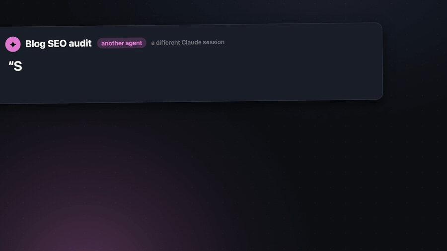
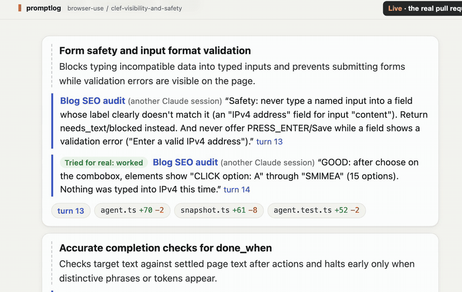
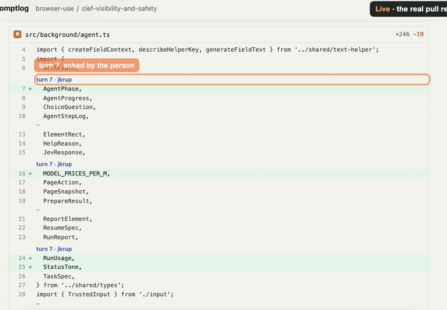
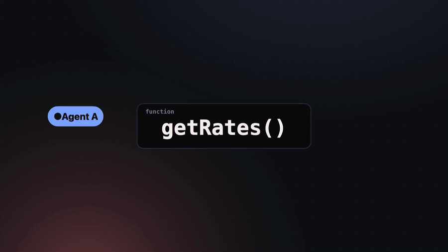

<div align="center">

# promptlog

**Review the conversation that built the code, not just the diff.**

   [](LICENSE)

[**Live demo**](https://promptlog-viewer.mazlix-f8e.workers.dev/review?base=main&head=feature%2Frates&repo=promptlog-demo) · [Homepage](https://promptlog-home.mazlix-f8e.workers.dev) · [Quick start](#quick-start-local) · [On Cloudflare](#on-cloudflare-artifacts--workers) · [Leases](#many-agents-one-file) · [Develop](#develop)

<br>



</div>

<br>

Most code is now written by AI agents in a conversation. The diff is the compiled output; the prompts, the agent's replies and the messages between agents are the source. promptlog records that source next to the code, in git, and shows a pull request as the conversation that produced it: who asked for what (a person or another agent), what the agent did, and the exact code Claude wrote in each turn.

- **One command per project.** `promptlog connect` sets up git if needed, records Claude Code sessions, creates a private Cloudflare Artifacts repo for the folder, brings in the folder's past Claude Code sessions (linked to the commits they made) and pushes. Nothing else changes in how you or your agents work.
- **promptlog pushes every commit.** When a person or an agent commits, promptlog pushes the branch and the conversation behind it to the Artifacts repo in the background. Uncommitted work never leaves the machine. Branches are PRs.
- **Many agents, one review.** Sessions that message each other (Claude Code peer messages) show up as turns from that agent. Each agent's commits arrive with their reasons.
- **Hosted on Cloudflare.** A Worker serves the review page from the Artifacts repo (via a Container running the viewer). DeepSeek on Workers AI writes the summaries and Clef-flash makes the small typed decisions, with no API keys in the container.

Built for Cloudflare's "Build the next GitHub" challenge. MIT licensed.

## What changed, and why



The top of each PR page summarizes what changed. Under each change is the message that asked for it, quoted word for word, with who sent it. promptlog checks every quote against the saved conversation in code, so a made-up reason doesn't get through.

## Every line, traced to its turn



The Files tab credits each changed line to the turn in which Claude wrote it: from exact before/after snapshots when recorded live, otherwise from the code inside that turn's own tool calls (agents often edit through Bash scripts). A label links to its turn. On a real 1,121-line PR, 96% of lines are traced.

## Many agents, one file



Before an agent edits code, it takes a lease on the function it is about to change (or the class method, or the declaration). Another agent can work on a different function of the same file at the same time. The same function is refused, and the agent is told who holds it, on which branch, and what they were asked.

When two agents want functions right next to each other, Clef-flash answers one narrow question: are the two changes independent? Only a clear yes (70% or more) lets the second agent in, with a heads-up about its neighbour. Every verdict is kept and shown on `/leases` ([public demo](https://promptlog-viewer.mazlix-f8e.workers.dev/leases?repo=promptlog-demo)). Details are [below](#how-leases-work).

## Quick start (local)

Needs Node 22.18 or newer, git, and Claude Code. For a look without installing anything, open the [live demo](https://promptlog-viewer.mazlix-f8e.workers.dev/review?base=main&head=feature%2Frates&repo=promptlog-demo).

```sh
git clone <this repo> promptlog && cd promptlog && npm install
mkdir -p ~/.local/bin && ln -s "$PWD/bin/promptlog" ~/.local/bin/promptlog   # ~/.local/bin must be on PATH

cd ~/code/your-project
promptlog install          # record Claude Code sessions here (hooks in .claude/settings.local.json + git hooks)
# ...use Claude Code and commit as usual...
promptlog ls               # recorded sessions
promptlog view main..my-branch   # the review UI for a branch, on http://127.0.0.1:4777
promptlog import <transcript.jsonl>   # bring in a past Claude Code session (~/.claude/projects/...)
```

Try it on the included demo, nothing to install beyond `npm install`:

```sh
git clone -q fixtures/demo.bundle /tmp/demo && cd /tmp/demo \
  && git fetch -q origin '+refs/promptlog/*:refs/promptlog/*' && git checkout -q feature/rates \
  && git branch -f main origin/main && ~/path/to/promptlog/bin/promptlog view main..feature/rates
```

## On Cloudflare (Artifacts + Workers)

Needs a Cloudflare account on Workers Paid, and wrangler logged in (`npx wrangler login`).

1. **Connect a project to Artifacts:**
   ```sh
   cd ~/code/your-project
   promptlog connect          # private Artifacts repo in namespace "promptlog", past sessions, first push
   ```
   From then on promptlog pushes every commit (and the conversation behind it) automatically. `promptlog mirror` pushes by hand.
2. **Deploy the review page** (`cloud/viewer`: a Worker plus a Container running `promptlog view` against the Artifacts repo):
   ```sh
   cd cloud/viewer && npm install
   npx wrangler secret put VIEW_KEY     # any long random string; open the page once with ?key=<VIEW_KEY>
   npx wrangler deploy                   # Docker must be running (the Container image is built locally)
   ```
   `REPO` in `cloud/viewer/wrangler.jsonc` is the default repo; `?repo=<name>` switches to another repo in the namespace. PR pages are `/review?base=main&head=<branch>`.
   After a deploy, the Container keeps its old image until it restarts: open `/__restart` (with the key) once the new image has rolled out.
3. **Share leases across machines.** By default, leases cover the worktrees of one machine. To cover every machine working on the repo, point each clone at the Worker:
   ```sh
   promptlog connect --no-backfill --leases https://promptlog-viewer.<you>.workers.dev --leases-key <key>
   ```
   The key is per repo. Open `/leases?repo=<name>` on the review page (with your view key) and copy the full command from there. On a Mac the key goes to the Keychain; elsewhere to `git config promptlog.leasesKey`. The table lives in a Durable Object, one per repo. `/leases` shows who's working on what (each agent session, its branch, what it was asked, and the functions or files it holds) and Clef's recent decisions in plain words. If the Worker doesn't answer in time, agents use the machine's own table for a minute and log the problem to `.git/promptlog/errors.log`. They are never blocked.
4. **A public demo.** `PUBLIC_REPOS` in `wrangler.jsonc` lists repos anyone can open without the key. Visitors can only read pages: no asks, no AI, no restarts. Every other repo still needs the key. The bundled demo is published that way: [the PR page for `feature/rates`](https://promptlog-viewer.mazlix-f8e.workers.dev/review?base=main&head=feature%2Frates&repo=promptlog-demo).

### How leases work

- An `Edit` holds the block it lands in: the top-level function, class or declaration around it, or just the method when the edit stays inside one. Blocks are found by bracket matching in C-like files (JS/TS, Go, Rust, Java, C, CSS...) and by indentation in Python. Anything else holds the edited lines and five lines around them. `Write`, `NotebookEdit` and shell commands that write a file hold the whole file.
- Other agents' copies of a file can be out of date, so each block is found again by its first line before two blocks are compared.
- Different blocks: both agents go ahead. The same block, or a file someone holds whole: refused.
- The gray zone (blocks within 3 lines of each other, or the same block left untouched for 5 minutes): the Durable Object asks Clef-flash through Workers AI, with both agents' asks, both blocks' code and the new edit. "Independent" at 70% or more lets the edit through. Claude Code then shows the agent a heads-up (the hook adds context; it never approves anything the user's own permission rules would ask about). Anything else, or no answer within 1.5 seconds, is refused. A verdict is reused for the same two blocks and asks.
- Without a shared table, the decision endpoint in `~/.config/promptlog/config.json` (any Jev-shaped `/v1/systemone`) is asked instead. With none set up, the gray zone is refused, to be safe.
- `demo/lease-capture.sh` plays the whole story with two worktrees (set `LEASES_URL` and `LEASES_KEY_FILE` to use a shared table).

## Develop

```sh
npm test            # node:test, no network
npm run typecheck
```

TypeScript runs directly on Node (type stripping), no build step and no runtime dependencies. Layout: `src/core` (git storage, transcripts, review assembly, line attribution), `src/capture` (hooks, import, connect, mirror), `src/viewer` (pure HTML rendering + local server), `src/quick` (cheap model calls), `cloud/` (Workers). Storage format: `docs/format.md`. Contest plan and notes: `docs/cloudflare-challenge.md`.

<div align="center">
<br>

[Live demo](https://promptlog-viewer.mazlix-f8e.workers.dev/review?base=main&head=feature%2Frates&repo=promptlog-demo) · [Homepage](https://promptlog-home.mazlix-f8e.workers.dev) · MIT license

</div>
